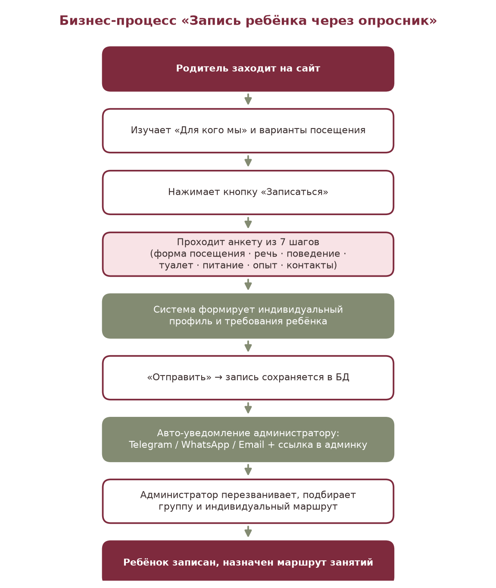
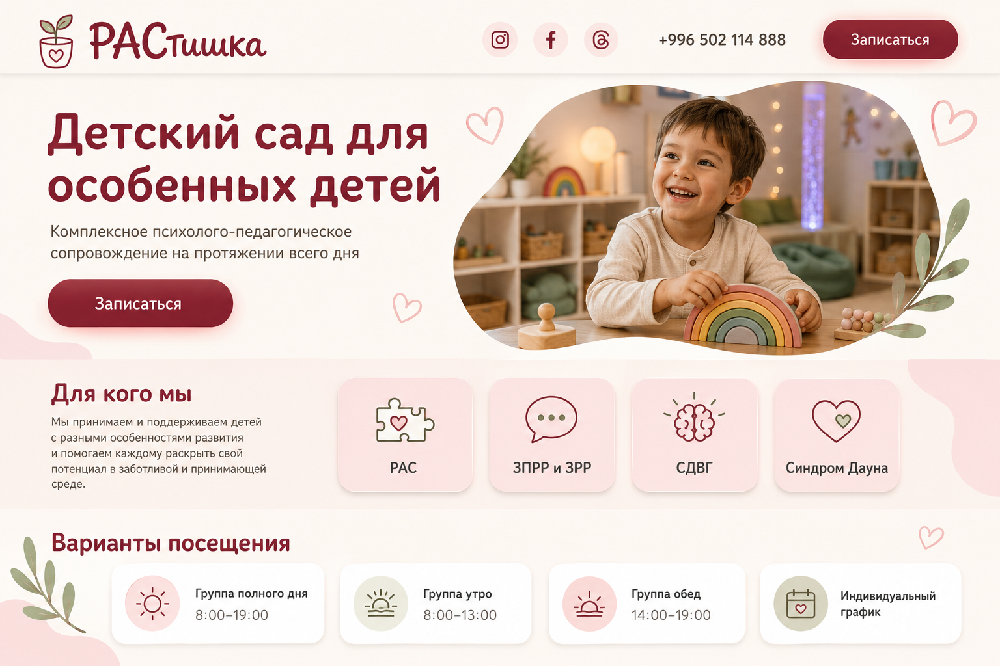
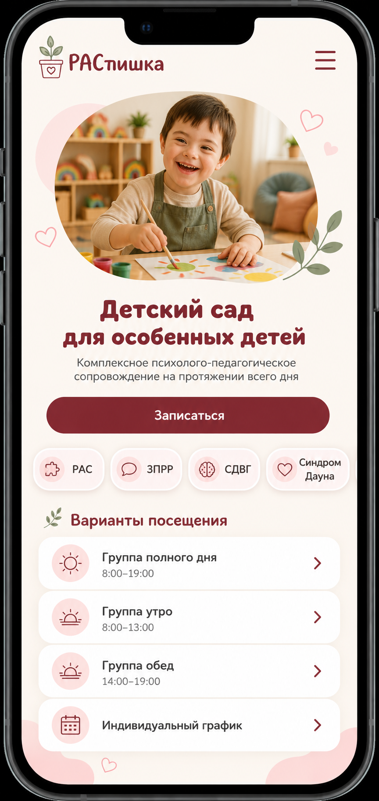
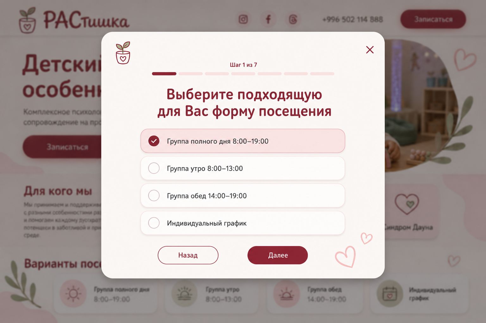
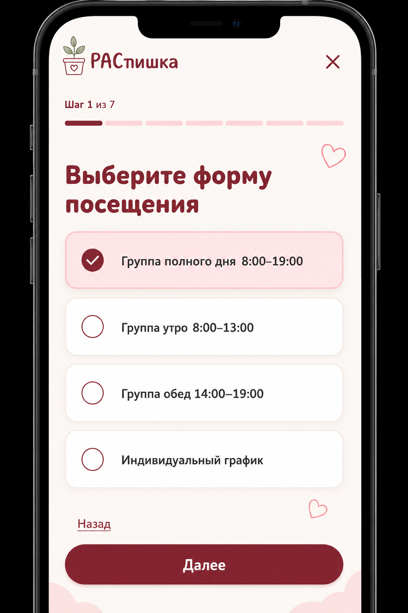

# МИНИСТЕРСТВО НАУКИ, ВЫСШЕГО ОБРАЗОВАНИЯ И ИННОВАЦИЙ КЫРГЫЗСКОЙ РЕСПУБЛИКИ

## КЫРГЫЗСКИЙ ГОСУДАРСТВЕННЫЙ ТЕХНИЧЕСКИЙ УНИВЕРСИТЕТ ИМЕНИ И. РАЗЗАКОВА

### Кафедра программного обеспечения компьютерных систем

 
 

# ОТЧЁТ ПО ПРОИЗВОДСТВЕННОЙ ПРАКТИКЕ

## на тему

# «ПРОЕКТИРОВАНИЕ И РАЗРАБОТКА ПОЛЬЗОВАТЕЛЬСКОГО ИНТЕРФЕЙСА САЙТА КОРРЕКЦИОННОГО ДЕТСКОГО САДА “РАСТИШКА”»

 

Направление подготовки: **710400 «Программная инженерия»**

 
 

Выполнила: студентка группы **[УКАЗАТЬ ГРУППУ]**  
**[УКАЗАТЬ ФИО]**

Руководитель практики: **[УКАЗАТЬ ФИО И ДОЛЖНОСТЬ]**

 
 

**Бишкек 2026**

---

# Аннотация

В отчёте представлены результаты проектирования и разработки пользовательской части веб-сайта коррекционного детского сада «РАСтишка». Работа охватывает анализ предметной области, определение требований к публичному интерфейсу, разработку пользовательских сценариев, создание адаптивного UX/UI-дизайна, реализацию публичных страниц и семишаговой анкеты предварительной записи ребёнка, а также проверку качества созданного интерфейса.

Основными объектами анализа являются информационный путь родителя, выбор формата посещения, заполнение анкеты, просмотр новостей и вакансий, взаимодействие с контактной информацией и получение понятной обратной связи после отправки формы. Особое внимание уделено этичным формулировкам, доступности интерфейса, сохранению введённых данных, адаптации под мобильные устройства и снижению тревожности пользователя при работе с формой.

Публичная часть реализована с использованием Next.js 16, React 19 и TypeScript. Для оформления применяются Tailwind CSS и компоненты shadcn/ui, для управления формой - React Hook Form, для декларативной проверки данных - Zod, а для хранения состояния открытия анкеты и источника перехода - Zustand. Интерфейс построен на основе App Router и включает серверные и клиентские компоненты.

Отчёт состоит из введения, четырёх глав, заключения, глоссария, списка источников и приложений. В первой главе рассматриваются предметная область и требования. Во второй главе описываются пользовательская модель, информационная архитектура, бизнес-процесс записи и дизайн-система. Третья глава посвящена реализации публичных страниц и анкеты. В четвёртой главе представлены план и результаты тестирования.

**Ключевые слова:** веб-сайт, UX, UI, адаптивный дизайн, доступность, Next.js, React, TypeScript, анкета, валидация, детский сад.

---

# Содержание

1. Введение
2. Глава 1. Анализ и разработка требований
   1. Обзор существующих подходов
   2. Обоснование необходимости разработки
   3. Основание и область применения
   4. Анализ участников и источников требований
   5. Бизнес-требования
   6. Пользовательские требования
   7. Бизнес-правила
   8. Функциональные требования
   9. Нефункциональные требования
   10. Организация входных и выходных данных
3. Глава 2. Проектная работа
   1. Концептуальная модель
   2. Бизнес-процесс записи ребёнка
   3. Информационная архитектура
   4. Проектирование семишаговой анкеты
   5. Дизайн-система
   6. Адаптивные макеты
   7. Компонентная модель
   8. Выбор технологий
4. Глава 3. Документация разработки
   1. Требования к программному и аппаратному обеспечению
   2. Руководство программиста
   3. Структура проекта
   4. Реализация публичных страниц
   5. Реализация анкеты
   6. Доступность и SEO
   7. Инструкция по запуску
   8. Руководство пользователя
5. Глава 4. Экспериментальная часть
   1. План тестирования
   2. Автоматические проверки
   3. Тестирование пользовательских сценариев
   4. Адаптивное и визуальное тестирование
   5. Результаты и ограничения
6. Заключение
7. Глоссарий
8. Список использованных источников
9. Приложения

---

# Введение

Веб-сайт образовательной и коррекционной организации является не только информационным ресурсом, но и первым этапом взаимодействия семьи с учреждением. Для родителей детей с особенностями развития этот этап особенно важен: пользователю необходимо быстро понять, для кого работает организация, какие форматы посещения доступны, каким образом происходит предварительная запись и что будет сделано с переданными данными. Неясная структура сайта, сложная форма или некорректные медицинские обещания могут снизить доверие и привести к отказу от обращения.

Проект «РАСтишка» создаётся для частного коррекционного детского сада, работающего с детьми с расстройствами аутистического спектра, задержками речевого и психоречевого развития, синдромом дефицита внимания и гиперактивности, синдромом Дауна и сенсорными трудностями. Согласно техническому заданию, сайт должен превратить тревожный для родителя выбор в понятный последовательный путь: предоставить основную информацию, помочь выбрать формат посещения, собрать первичные сведения о потребностях ребёнка и передать заявку администрации [1].

Актуальность работы связана с необходимостью объединить в одном интерфейсе несколько задач. Сайт должен быть понятным для посетителя без технической подготовки, корректно работать на мобильном устройстве, поддерживать этичную коммуникацию, обеспечивать доступность интерактивных элементов и не терять данные при ошибке отправки. Одновременно публичные страницы должны поддерживать актуальный контент, поисковую индексацию и переход к основному целевому действию - открытию анкеты записи.

Объектом исследования является процесс информирования родителя и предварительной записи ребёнка в коррекционный детский сад через веб-интерфейс.

Предметом исследования являются методы проектирования UX/UI и средства фронтенд-разработки, применяемые для создания адаптивного публичного сайта и многошаговой формы.

Цель работы - спроектировать и реализовать адаптивную пользовательскую часть сайта «РАСтишка», которая предоставляет посетителю понятную информацию и позволяет пройти семишаговую анкету предварительной записи.

Для достижения цели были поставлены следующие задачи:

- изучить предметную область и потребности целевой аудитории;
- проанализировать исходные материалы и границы MVP;
- сформировать бизнес-, пользовательские, функциональные и нефункциональные требования к публичной части;
- разработать структуру сайта и основные пользовательские сценарии;
- создать дизайн-систему и адаптивные макеты;
- реализовать главную страницу, новости, вакансии, контакты и политику обработки данных;
- реализовать семишаговую анкету с пошаговой проверкой данных;
- обеспечить сохранение введённых значений при навигации и серверных ошибках;
- обеспечить доступность интерфейса и базовую поисковую оптимизацию;
- провести автоматические, адаптивные и пользовательские проверки;
- подготовить публичную часть к приёмке на staging и production.

При выполнении работы применялись анализ требований, моделирование пользовательских сценариев, компонентное проектирование, адаптивная вёрстка, декларативная валидация, модульное тестирование и визуальная проверка интерфейса.

Практическая значимость работы заключается в создании интерфейса, которым может пользоваться реальная организация: родитель получает понятную точку входа и пошаговую форму, а сайт формирует единый канал поступления структурированных заявок.

Работа выполнена в составе команды из двух человек. В данном отчёте рассматриваются техническое задание в части пользовательского опыта, UX/UI, публичные страницы и клиентская часть анкеты. Серверная архитектура, база данных, админ-панель, внешние уведомления и production-инфраструктура подробно рассматриваются во втором отчёте.

# ГЛАВА 1. АНАЛИЗ И РАЗРАБОТКА ТРЕБОВАНИЙ

## 1.1. Обзор существующих подходов

До создания отдельного сайта небольшие образовательные организации часто используют социальные сети и мессенджеры как основной канал связи. Этот вариант позволяет быстро публиковать новости и фотографии, но информация распределяется по отдельным публикациям, отсутствует единая структура услуг, а обращение пользователя превращается в свободное сообщение администратору. В результате сотруднику приходится вручную уточнять одни и те же сведения.

Другой распространённый вариант - типовой сайт детского сада. Обычно он содержит главную страницу, описание услуг, контакты и форму обратного звонка. Такой интерфейс решает информационную задачу, но короткая форма из имени и телефона не помогает заранее понять потребности ребёнка.

Для проекта «РАСтишка» выбран третий подход: публичный информационный сайт объединён с многошаговой предварительной анкетой. Анкета не ставит диагноз и не принимает решение о зачислении. Она структурирует исходные сведения, необходимые для последующего разговора со специалистом.

**Таблица 1 - Сравнение подходов**

| Критерий | Социальные сети | Типовой сайт детского сада | Разработанная система |
| --- | --- | --- | --- |
| Структурированная информация | Ограничена форматом публикаций | Обычно присутствует | Разделена по задачам пользователя |
| Единый путь к записи | Как правило, через личные сообщения | Простая контактная форма | Семишаговая анкета |
| Предварительный выбор режима | Отсутствует | Встречается редко | Четыре варианта посещения |
| Сбор сведений о потребностях | В свободной переписке | Обычно отсутствует | Последовательные тематические шаги |
| Проверка данных | Зависит от мессенджера | Базовая | Пошаговая и итоговая |
| Сохранение ответов при переходах | Не применяется | Зависит от формы | Поддерживается внутри анкеты |
| Адаптация под mobile | Зависит от платформы | Зависит от шаблона | Заложена в требования и макеты |
| SEO для отдельных материалов | Ограничено | Обычно возможно | Реализованы metadata, sitemap и robots |
| Доступность интерфейса | Контролируется платформой | Зависит от реализации | Учтены focus, клавиатура, ошибки и reduced motion |

Сравнение показывает, что отдельная разработка оправдана не количеством страниц, а необходимостью сформировать бережный и управляемый путь пользователя. В проекте требуется связать информацию о детском саде, выбор формата посещения, последовательный опрос и понятное завершение сценария.

## 1.2. Обоснование необходимости разработки

Основная проблема исходного процесса состояла в разрозненности информации и ручном сборе обращений. Родитель мог получить сведения из социальных сетей или по телефону, но сотруднику приходилось повторно выяснять режим посещения, особенности речи, поведения, бытовые и пищевые навыки, а также предыдущий опыт занятий.

Публичный сайт решает следующие задачи:

- объясняет назначение и формат работы организации;
- снижает неопределённость перед первым обращением;
- показывает доступные варианты посещения;
- предоставляет единое целевое действие «Записаться»;
- собирает сведения в одинаковой последовательности;
- помогает избежать пропуска обязательного вопроса;
- предоставляет понятный результат отправки;
- создаёт основу для последующей обработки заявки.

Необходимость собственной реализации также связана с этикой предметной области. Сайт не должен использовать обещания «вылечить» или «гарантировать результат». На публичных страницах применяются формулировки «поддержка», «сопровождение», «адаптация» и «индивидуальный маршрут». Анкета позиционируется как предварительная, а окончательное решение принимается специалистом после контакта с родителем.

## 1.3. Основание и область применения

Основанием для разработки являются задание на производственную практику, финальное техническое задание версии 1.1, анализ предметной области, утверждённые desktop/mobile-макеты и трекер требований MVP [1-4].

Область применения пользовательской части включает:

- первичное знакомство с организацией;
- просмотр информации о целевой аудитории сада;
- выбор формата посещения;
- предварительную запись ребёнка;
- чтение новостей;
- просмотр вакансий и переход к отклику;
- просмотр контактов и социальных ссылок;
- ознакомление с политикой обработки персональных данных.

За границами текущего MVP находятся личный кабинет родителя, онлайн-расписание, мультиязычность, закрытая галерея детей, онлайн-оплата и сложная рекомендательная система [2].

## 1.4. Анализ участников и источников требований

Требования формировались от потребностей внешних пользователей, внутренних участников организации, юридических ограничений и возможностей выбранной технологической платформы.

**Таблица 2 - Участники и источники требований**

| Участник или источник | Роль в проекте | Основной интерес |
| --- | --- | --- |
| Родитель или посетитель | Основной пользователь публичной части | Понять назначение сада и отправить заявку |
| Соискатель | Пользователь раздела вакансий | Изучить условия и перейти к отклику |
| Контент-менеджер | Источник актуального публичного контента | Публиковать новости и вакансии |
| Администратор | Получатель заявки | Получить полные и корректные данные |
| Владелец продукта | Утверждает содержание и приоритеты | Соответствие сайта процессам организации |
| Юрист или ответственный за ПДн | Определяет юридические ограничения | Законное основание сбора и хранения данных |
| Финальное ТЗ v1.1 | Основной источник требований | Границы MVP и критерии приёмки |
| Desktop/mobile-макеты | Источник визуальных требований | Композиция, стиль и адаптивное поведение |
| WCAG 2.2 | Источник требований доступности | Управляемость, понятность и доступность интерфейса |

## 1.5. Бизнес-требования

Бизнес-требования описывают результат, который организация должна получить от пользовательской части, без привязки к конкретному коду.

**Таблица 3 - Бизнес-требования публичной части**

| Код | Требование |
| --- | --- |
| BR-UI-01 | Сайт должен понятно объяснять, для кого работает детский сад. |
| BR-UI-02 | Посетитель должен видеть доступные варианты посещения и их время. |
| BR-UI-03 | Пользователь должен иметь возможность начать запись с ключевых страниц. |
| BR-UI-04 | Предварительная анкета должна собирать сведения в едином формате. |
| BR-UI-05 | Интерфейс должен снижать вероятность незаполненных обязательных данных. |
| BR-UI-06 | Ошибка отправки не должна приводить к потере введённых ответов. |
| BR-UI-07 | Пользователь должен получить однозначное подтверждение успешной отправки. |
| BR-UI-08 | Сайт должен корректно работать на мобильных и настольных устройствах. |
| BR-UI-09 | Публичные тексты должны быть этичными и не содержать медицинских обещаний. |
| BR-UI-10 | Новости и вакансии должны иметь отдельные публичные маршруты. |
| BR-UI-11 | Основные страницы должны поддерживать поисковую индексацию. |
| BR-UI-12 | До отправки персональных данных пользователь должен принять явное согласие. |

## 1.6. Пользовательские требования

Пользовательские требования описывают возможности с точки зрения посетителя.

**Таблица 4 - Пользовательские требования**

| Код | Требование пользователя | Основание |
| --- | --- | --- |
| UR-01 | Я хочу с первой страницы понять назначение детского сада. | BR-UI-01 |
| UR-02 | Я хочу увидеть, с какими особенностями развития работает организация. | BR-UI-01 |
| UR-03 | Я хочу сравнить варианты посещения и время занятий. | BR-UI-02 |
| UR-04 | Я хочу открыть анкету кнопкой «Записаться». | BR-UI-03 |
| UR-05 | Я хочу вернуться к предыдущему шагу без потери ответов. | BR-UI-04 |
| UR-06 | Я хочу видеть номер текущего шага и общий прогресс. | BR-UI-04 |
| UR-07 | Я хочу получать понятную ошибку рядом с неверно заполненным полем. | BR-UI-05 |
| UR-08 | Я хочу вводить номер Кыргызстана в привычном формате. | BR-UI-05 |
| UR-09 | Я хочу исправить данные после ошибки отправки без повторного заполнения анкеты. | BR-UI-06 |
| UR-10 | Я хочу получить подтверждение, что анкета принята. | BR-UI-07 |
| UR-11 | Я хочу пользоваться сайтом с телефона. | BR-UI-08 |
| UR-12 | Я хочу прочитать новости и открытые вакансии. | BR-UI-10 |
| UR-13 | Я хочу быстро найти телефон, адрес и социальные сети. | BR-UI-03 |
| UR-14 | Я хочу ознакомиться с политикой обработки данных до отправки формы. | BR-UI-12 |

## 1.7. Бизнес-правила

При разработке публичной части зафиксированы следующие правила:

- анкета является предварительной заявкой и не гарантирует зачисление;
- кнопка «Записаться» должна быть доступна на ключевых публичных страницах;
- анкета состоит из семи логически связанных шагов;
- при выборе индивидуального графика требуется текстовое пояснение;
- при наличии особенностей поведения требуется краткое описание;
- на шаге питания разрешён выбор нескольких вариантов;
- номер телефона должен соответствовать формату Кыргызстана;
- отправка без согласия на обработку персональных данных запрещена;
- после начала отправки кнопка блокируется до получения результата;
- серверная ошибка не должна очищать заполненные поля;
- в публичной части выводятся только опубликованные новости и вакансии;
- административные и API-маршруты не должны попадать в поисковую индексацию;
- движение и анимации должны отключаться или сокращаться при настройке reduced motion;
- формулировки не должны заменять медицинскую диагностику или обещать гарантированный результат.

## 1.8. Функциональные требования

Функциональные требования взяты из финального ТЗ и рабочего трекера MVP. В таблице приведены требования, относящиеся к зоне ответственности первого участника.

**Таблица 5 - Основные функциональные требования**

| ID | Приоритет | Требование | Критерий приёмки |
| --- | --- | --- | --- |
| FR-COM-01 | P0 | Адаптивные desktop/mobile-версии | Нет горизонтального скролла, перекрытий и недоступных CTA |
| FR-COM-02 | P0 | Header с логотипом, соцсетями, телефоном, CTA и burger-меню | Все элементы доступны и выполняют ожидаемое действие |
| FR-COM-03 | P0 | CTA записи на ключевых страницах | Анкета открывается с главной, новостей и вакансий |
| FR-COM-06 | P0 | Маска и проверка телефона +996 | Некорректный номер не отправляется |
| FR-COM-07 | P0 | Согласие и ссылка на политику ПДн | Без согласия отправка блокируется |
| FR-COM-10 | P1 | Полевая ошибка без потери данных | Ошибка показана рядом с полем, ответы сохранены |
| FR-MAIN-01 | P0 | Hero с кнопкой записи | CTA заметен и открывает анкету |
| FR-MAIN-03 | P0 | Карточки «Для кого мы» | Карточки корректно отображаются на desktop/mobile |
| FR-MAIN-04 | P0 | Четыре варианта посещения | Выбор карточки передаётся в первый шаг анкеты |
| FR-MAIN-05 | P1 | Последние новости на главной | Отображаются последние опубликованные записи |
| FR-MAIN-06 | P1 | Контакты и карта | Данные доступны с публичной страницы |
| FR-APP-01 | P0 | Модальное окно, шаги и progress bar | Видны текущий шаг и общий прогресс |
| FR-APP-02 | P0 | Переходы «Далее» и «Назад» | Ответы сохраняются между шагами |
| FR-APP-03 | P0 | Шаг выбора посещения | Доступны четыре варианта |
| FR-APP-04 | P0 | Поле индивидуального графика | Поле появляется только для соответствующего выбора |
| FR-APP-05 | P0 | Шаг развития речи | Доступны варианты из ТЗ |
| FR-APP-06 | P0 | Шаг особенностей поведения | При положительном ответе запрашивается пояснение |
| FR-APP-07 | P0 | Шаг навыков туалета | Можно выбрать один вариант |
| FR-APP-08 | P0 | Шаг навыков питания | Можно выбрать несколько вариантов |
| FR-APP-09 | P0 | Шаг предыдущего опыта | Можно выбрать один вариант |
| FR-APP-10 | P0 | Шаг контактов | Проверяются имя и телефон |
| FR-APP-11 | P0 | Согласие на обработку данных | Чекбокс обязателен |
| FR-APP-13 | P0 | Сообщение об успехе | Пользователь получает понятное подтверждение |
| FR-APP-14 | P0 | Понятная ошибка и безопасный повтор | Данные сохраняются, повтор не создаёт дубль |
| FR-NEWS-01 | P0 | Список опубликованных новостей | Записи отсортированы от новых к старым |
| FR-NEWS-02 | P0 | Карточка новости | Есть изображение, заголовок, дата и ссылка |
| FR-NEWS-04 | P0 | Детальная страница новости | Доступен полный текст |
| FR-VAC-01 | P0 | Публичная страница вакансий | Есть вводный текст и активные вакансии |
| FR-VAC-03 | P0 | Карточка вакансии | Превью не разрушает компоновку |
| FR-VAC-04 | P0 | Детальная страница вакансии | Видны обязанности, требования и условия |

## 1.9. Нефункциональные требования

Нефункциональные требования определяют свойства качества пользовательской части.

**Таблица 6 - Нефункциональные требования**

| Код | Категория | Требование |
| --- | --- | --- |
| NFR-UI-01 | Адаптивность | Интерфейс должен корректно работать как минимум на ширинах 390, 768 и 1440 пикселей. |
| NFR-UI-02 | Доступность | Управление должно быть доступно с клавиатуры, а focus - визуально заметен. |
| NFR-UI-03 | Понятность | Ошибки должны описывать способ исправления и находиться рядом с полем. |
| NFR-UI-04 | Надёжность UX | Серверная ошибка не должна очищать заполненную анкету. |
| NFR-UI-05 | Производительность | Публичные страницы должны собираться в production-режиме без ошибок. |
| NFR-UI-06 | Совместимость | Интерфейс должен использовать стандартные HTML-контролы и семантическую разметку. |
| NFR-UI-07 | Движение | При prefers-reduced-motion анимации должны быть сведены к минимуму. |
| NFR-UI-08 | SEO | Страницы должны иметь title, description и корректные индексируемые маршруты. |
| NFR-UI-09 | Безопасность данных | Персональные данные не должны передаваться в URL. |
| NFR-UI-10 | Поддерживаемость | Повторяющиеся элементы должны быть выделены в переиспользуемые компоненты. |
| NFR-UI-11 | Локализация | Для MVP используется русский язык; структура не должна исключать дальнейшее расширение. |
| NFR-UI-12 | Этичность | Тексты должны быть проверены ответственным представителем организации. |

Требования к доступности сопоставлялись с WCAG 2.2. Особое значение имеют видимость клавиатурного фокуса, достаточный размер интерактивных целей, предсказуемое поведение элементов и идентификация ошибок [15].

## 1.10. Организация входных и выходных данных

Входные данные пользовательской части делятся на навигационные и анкетные.

К навигационным данным относятся выбранная страница, выбранный формат посещения, источник CTA и UTM-параметры. Анкетные данные включают формат посещения, комментарий к индивидуальному графику, уровень речи, сведения о поведении, бытовые и пищевые навыки, предыдущий опыт, имя родителя, телефон и согласие.

**Таблица 7 - Входные данные анкеты**

| Шаг | Поля | Тип выбора | Основная проверка |
| --- | --- | --- | --- |
| 1 | Формат посещения, пояснение к графику | Один вариант и условный текст | Пояснение обязательно для индивидуального режима |
| 2 | Развитие речи | Один вариант | Значение должно входить в установленный список |
| 3 | Особенности поведения, пояснение | Один вариант и условный текст | Пояснение обязательно при наличии особенностей |
| 4 | Навыки туалета | Один вариант | Значение должно входить в установленный список |
| 5 | Навыки питания | Несколько вариантов | Требуется минимум один вариант |
| 6 | Предыдущий опыт | Один вариант | Значение должно входить в установленный список |
| 7 | Имя, телефон, согласие | Текст, телефон, checkbox | Корректное имя, номер +996 и принятое согласие |

Выходными данными для пользователя являются:

- отображение актуального шага и прогресса;
- полевые сообщения об ошибках;
- общее сообщение при серверной ошибке;
- состояние ожидания во время отправки;
- подтверждение успешного сохранения анкеты;
- публично отображаемые новости, вакансии и контактные данные.

# ГЛАВА 2. ПРОЕКТНАЯ РАБОТА

## 2.1. Концептуальная модель

В рамках пользовательской части основными акторами являются родитель и соискатель. Родитель изучает информацию, выбирает формат посещения и запускает анкету. Соискатель просматривает вакансии и переходит к форме отклика. Публичный интерфейс получает опубликованный контент и настройки сайта от серверной части, но детали администрирования не входят в область данного отчёта.

Концептуально публичная часть состоит из следующих подсистем:

1. Общий слой навигации: header, footer, ссылки, контакты и глобальный CTA.
2. Главная страница: hero, целевая аудитория, форматы посещения, новости и контакты.
3. Контентные разделы: список и детальные страницы новостей и вакансий.
4. Анкета: модальное окно, семь шагов, состояние, валидация и обратная связь.
5. Слой доступности и SEO: семантика, focus, metadata, robots и sitemap.

Поток взаимодействия можно представить следующим образом:

**Посетитель -> публичная страница -> CTA «Записаться» -> анкета -> проверка шага -> итоговая отправка -> сообщение о результате.**

## 2.2. Бизнес-процесс записи ребёнка

Бизнес-процесс начинается с посещения сайта родителем. Пользователь изучает hero-блок, раздел «Для кого мы» и варианты посещения. После нажатия CTA открывается модальная анкета. На каждом шаге пользователь отвечает на отдельную группу вопросов. После заполнения контактов и принятия согласия данные проходят итоговую проверку и отправляются серверной части.

**Рисунок 1 - Бизнес-процесс записи ребёнка через анкету**

В интерфейсе предусмотрен более короткий путь: при выборе конкретной карточки посещения анкета открывается с заранее выбранным вариантом первого шага. Источник открытия также сохраняется в состоянии и передаётся скрытыми полями, что позволяет в дальнейшем оценивать эффективность CTA.

## 2.3. Информационная архитектура

Для публичной части используется плоская структура верхнего уровня и динамические детальные маршруты.

**Таблица 8 - Карта публичных маршрутов**

| Маршрут | Назначение |
| --- | --- |
| / | Главная страница и основной вход в анкету |
| /news | Список опубликованных новостей |
| /news/[slug] | Детальная страница новости |
| /vacancies | Список активных вакансий |
| /vacancies/[slug] | Детальная страница вакансии и переход к отклику |
| /contacts | Контактные данные и филиалы |
| /privacy | Политика обработки персональных данных |
| /robots.txt | Правила индексирования |
| /sitemap.xml | Карта публичных страниц |

На всех публичных страницах используется общий layout. Он выводит skip-link, header, основное содержимое, footer и глобальный экземпляр анкеты. Такое решение обеспечивает единое поведение CTA и предотвращает дублирование формы в каждой странице.

## 2.4. Проектирование семишаговой анкеты

Разделение анкеты на семь шагов основано на принципе постепенного раскрытия: пользователь видит только одну логическую группу вопросов и не сталкивается сразу с длинной формой. Каждый шаг имеет заголовок, элементы выбора, сообщение об ошибке и навигацию.

**Таблица 9 - Назначение шагов анкеты**

| Шаг | Вопрос | Пользовательская цель |
| --- | --- | --- |
| 1 | Какой формат посещения удобен? | Выбрать режим и при необходимости описать график |
| 2 | Как развивается речь ребёнка? | Указать один из предусмотренных уровней |
| 3 | Есть ли особенности поведения? | Указать наличие особенностей и пояснение |
| 4 | Как обстоят дела с туалетом? | Описать уровень бытовой самостоятельности |
| 5 | Какие навыки питания есть? | Выбрать один или несколько вариантов |
| 6 | Был ли опыт занятий? | Указать предыдущий опыт |
| 7 | Как связаться с родителем? | Ввести имя, телефон и принять согласие |

Переход к следующему шагу выполняется только после успешной проверки текущего набора полей. При ошибке focus переводится на первое некорректное поле. Возврат назад не сбрасывает введённые ответы.

Прогресс представлен семью сегментами и текстом «Шаг N из 7». Для вспомогательных технологий используется роль progressbar и атрибуты aria-valuemin, aria-valuemax и aria-valuenow.

## 2.5. Дизайн-система

Визуальная система основана на спокойной тёплой палитре. Основной бордовый цвет используется для заголовков и целевых действий, кремовый - как фон, пыльно-розовый - для мягких акцентов, шалфейный и мятный - для вторичных декоративных элементов.

**Таблица 10 - Основные цвета**

| Назначение | Цвет | HEX |
| --- | --- | --- |
| Основной брендовый | Бордовый | #7E2A3D |
| Акцентный | Пыльно-розовый | #F2C4CB |
| Мягкий фон | Бледно-розовый | #F8E3E6 |
| Дополнительный | Мятный | #9CCFC4 |
| Контрастный дополнительный | Тёмно-бирюзовый | #2C6F66 |
| Натуральный акцент | Шалфейный | #838B72 |
| Основной фон | Кремовый | #F7F1EA |
| Основной текст | Тёплый почти чёрный | #2A1A1E |

Для заголовков применяется Nunito с насыщенностью 600-800, для основного текста - Inter. Оба шрифта подключаются через механизм Next.js fonts и содержат кириллический набор символов.

Карточки имеют крупные скругления, светлый фон и мягкую тень. Интерактивные варианты анкеты используют отдельные состояния:

- обычное;
- hover;
- focus;
- выбранное;
- ошибочное;
- disabled;
- pending.

Декоративные сердца, листья и органические формы поддерживают фирменный образ, но не заменяют текстовое содержание. Бесконечное декоративное движение ограничено, а при системной настройке reduced motion длительность анимаций практически обнуляется.

## 2.6. Адаптивные макеты

Desktop-макет использует горизонтальный header, двухколоночный hero и сетки карточек. На mobile навигация заменяется burger-меню, hero перестраивается в вертикальную композицию, а карточки посещения размещаются в один столбец.

**Рисунок 2 - Desktop-макет главной страницы**

**Рисунок 3 - Mobile-макет главной страницы**

Анкета на desktop показывается как центрированное модальное окно поверх затемнённой страницы. На мобильном устройстве она занимает почти всю доступную область, сохраняя доступ к закрытию, прогрессу и основной кнопке.

**Рисунок 4 - Desktop-макет первого шага анкеты**

**Рисунок 5 - Mobile-макет первого шага анкеты**

## 2.7. Компонентная модель

Интерфейс разделён на компоненты по назначению.

**Таблица 11 - Основные группы компонентов**

| Группа | Примеры | Ответственность |
| --- | --- | --- |
| Layout | PublicHeader, Footer, Breadcrumbs, PageIntro | Общая структура публичных страниц |
| Brand | Logo, BrandMark, DoodleHeart, SocialLinks | Фирменные и контактные элементы |
| Home | Hero, AudienceSection, VisitFormatsSection | Секции главной страницы |
| Content | NewsCard, VacancyCard, ContentDate | Унифицированное представление контента |
| Anketa | AnketaTrigger, AnketaModal | Открытие и прохождение анкеты |
| UI | Button, Input, Label, Dialog, Checkbox | Базовые интерактивные элементы |

Серверные компоненты получают настройки и опубликованный контент. Клиентскими сделаны только те части, которым требуется интерактивное состояние: анкета, её триггеры и элементы формы. Такое разделение уменьшает объём клиентской логики и соответствует архитектуре App Router [6].

## 2.8. Выбор технологий

Для реализации публичной части рассматривались несколько подходов.

**Таблица 12 - Сравнение вариантов фронтенд-реализации**

| Подход | Преимущества | Ограничения для проекта | Решение |
| --- | --- | --- | --- |
| Статический HTML/CSS/JS | Простота публикации | Сложнее поддерживать динамические данные и общие компоненты | Не выбран |
| React SPA с Vite | Быстрая клиентская разработка | Для SEO и серверных данных требуется отдельный backend или дополнительная настройка | Не выбран как основа |
| Next.js App Router | Серверный рендеринг, маршрутизация, metadata и интеграция серверных функций | Требует понимания границы Server/Client Components | Выбран |
| Vue/Nuxt | Аналогичные SSR-возможности | Не соответствует выбранному командой стеку и готовым компонентам | Рассматривался как альтернатива |

**Таблица 13 - Обоснование выбранных инструментов**

| Инструмент | Назначение | Причина выбора |
| --- | --- | --- |
| TypeScript | Типизация компонентов и данных | Снижает вероятность несогласованности значений формы |
| React 19 | Компонентная модель интерфейса | Поддерживает повторное использование UI и актуальные механизмы форм |
| Next.js 16 | Маршруты, Server Components и metadata | Объединяет публичные страницы и серверный слой |
| Tailwind CSS 4 | Адаптивная вёрстка | Ускоряет реализацию состояний и responsive-правил |
| shadcn/ui | Базовые UI-компоненты | Даёт контролируемую разметку и стилизацию |
| React Hook Form | Управление анкетой | Хранит состояние и ошибки без лишних обновлений |
| Zod 4 | Схемы валидации | Позволяет описать полную и пошаговые схемы |
| Zustand | Глобальное состояние анкеты | Хранит открытие, предвыбор посещения и источник CTA |

# ГЛАВА 3. ДОКУМЕНТАЦИЯ РАЗРАБОТКИ

## 3.1. Требования к программному и аппаратному обеспечению

**Таблица 14 - Среда разработки и запуска**

| Категория | Минимальное требование | Рекомендуемое требование | Назначение |
| --- | --- | --- | --- |
| CPU | 2 ядра | 4 и более ядер | Локальная сборка и dev-сервер |
| RAM | 4 ГБ | 8-16 ГБ | Next.js, TypeScript и тесты |
| Node.js | Совместимая LTS-версия | Node.js 22 | Запуск инструментов проекта |
| Package manager | pnpm | pnpm 11.19.0 | Установка зависимостей |
| Браузер | Современный Chromium/Firefox/Safari | Последняя стабильная версия | Проверка интерфейса |
| ОС | Windows, macOS или Linux | Windows 11 или Linux | Разработка |
| Сеть | Требуется для установки пакетов | Стабильное подключение | Зависимости и внешние сервисы |

## 3.2. Руководство программиста

Проект организован как единое Next.js-приложение. Маршруты находятся в каталоге **src/app**, компоненты - в **src/components**, а повторно используемая логика - в **src/lib**.

Публичные маршруты объединены в route group **(public)**. Группа не влияет на URL, но позволяет назначить общий layout. В layout один раз подключаются header, footer и модальное окно анкеты.

Главная страница реализована как асинхронный серверный компонент. Она загружает настройки сайта и последние опубликованные новости, после чего передаёт данные секциям Hero, AudienceSection, VisitFormatsSection, LatestNewsSection и ContactsSection.

Интерактивная анкета помечена как клиентский компонент. Она использует React Hook Form для регистрации полей, useWatch для отслеживания выбранных вариантов, Zod resolver для полной проверки и отдельные пошаговые схемы.

При добавлении новой публичной функции необходимо:

1. Найти связанное требование в трекере MVP.
2. Проверить открытые продуктовые и юридические вопросы.
3. Сформулировать критерий приёмки.
4. Реализовать компонент или маршрут.
5. Добавить проверку для новой логики.
6. Выполнить typecheck, lint, test и build.
7. Для UI-изменения приложить desktop/mobile-скриншоты.

## 3.3. Структура проекта

**Таблица 15 - Структура пользовательской части**

| Путь | Содержание |
| --- | --- |
| src/app/(public) | Публичные страницы и общий layout |
| src/components/home | Секции главной страницы |
| src/components/layout | Header, footer и элементы навигации |
| src/components/brand | Логотип, социальные ссылки и декоративные мотивы |
| src/components/content | Карточки новостей и вакансий |
| src/components/anketa | Триггер и модальное окно анкеты |
| src/components/ui | Базовые элементы интерфейса |
| src/lib/anketa-store.ts | Состояние открытия анкеты и источника CTA |
| src/lib/validation/application.ts | Полная и пошаговые схемы анкеты |
| src/lib/phone-format.ts | Форматирование номера телефона |
| src/app/globals.css | Токены дизайн-системы, стили и анимации |
| src/app/layout.tsx | Шрифты и общие metadata |
| src/app/robots.ts | Правила индексации |
| src/app/sitemap.ts | Динамическая карта сайта |

## 3.4. Реализация публичных страниц

### Главная страница

Главная страница собирается из независимых смысловых секций. Hero содержит основное позиционирование и CTA. Секция «Для кого мы» описывает аудиторию организации. Блок вариантов посещения показывает четыре режима и позволяет открыть анкету с предвыбранным значением. Ниже размещаются последние новости и контакты.

### Header и footer

Header содержит логотип, навигацию, телефон, социальные ссылки и кнопку записи. На мобильном устройстве навигация сворачивается в меню. Телефон представлен как ссылка, чтобы пользователь мог совершить звонок непосредственно с мобильного устройства.

Footer дублирует основные контакты и помогает завершить навигационный путь. Логотип на всех страницах ведёт на главную.

### Новости

Страница новостей отображает опубликованные записи в виде карточек. Карточка содержит изображение, дату, заголовок, краткий текст и ссылку. Детальная страница использует slug и выводит полный материал.

### Вакансии

Публичная страница вакансий содержит вводный текст и активные предложения. Карточка показывает безопасное короткое превью, а детальная страница - обязанности, требования и условия. В данном отчёте рассматривается публичное представление; сохранение отклика относится к серверной части проекта.

### Контакты и политика

Контактная страница объединяет телефон, адреса и социальные сети. Страница политики доступна по постоянному публичному маршруту и связана с чекбоксом согласия в анкете.

## 3.5. Реализация анкеты

Анкета реализована внутри компонента AnketaModal. Для каждого нового открытия создаётся экземпляр AnketaForm с начальными значениями. Первый шаг может получить предвыбранный формат посещения из Zustand store.

Полная схема applicationSchema описывает все значения анкеты. Дополнительные refine-правила проверяют условные поля:

- individualNote обязателен при выборе индивидуального графика;
- behaviorNote обязателен при выборе варианта с особенностями поведения.

Объект stepSchemas содержит отдельную схему для каждого шага. При нажатии «Далее» проверяется только текущая группа полей. Если проверка не пройдена, компонент устанавливает ошибки и переводит focus на первое неверное поле.

На последнем шаге вызывается полная проверка. После успешной проверки форма создаёт FormData и передаёт данные Server Action. Для защиты от повторной отправки генерируется уникальный idempotency key. Во время ожидания кнопка отключена, а её текст меняется на «Отправляем…».

Если сервер возвращает полевые ошибки, они переносятся в состояние React Hook Form. Введённые значения остаются на месте. При успешном результате вместо формы отображаются иконка подтверждения, заголовок «Анкета отправлена», поясняющий текст и кнопка закрытия.

В форму также включены:

- скрытые значения sourcePage и sourceCta;
- UTM-параметры;
- скрытое honeypot-поле для базовой антиспам-проверки;
- метод POST, исключающий попадание персональных данных в URL.

## 3.6. Доступность и SEO

В общий публичный layout добавлена ссылка перехода к основному содержимому. Она становится видимой при клавиатурном focus. Основное содержимое имеет стабильный идентификатор main-content.

Поля анкеты объединены в fieldset, а вопрос шага задаётся через legend. Ошибки имеют роль alert и связываются с полями через aria-describedby. Для progress bar передаются числовые ARIA-атрибуты.

Стили учитывают:

- заметные focus-состояния;
- достаточные размеры интерактивных областей;
- контраст основного текста и CTA;
- управление клавиатурой;
- reduced motion;
- отсутствие зависимости смысла только от цвета.

В корневом layout заданы metadataBase, шаблон title, description и Open Graph-настройки. Next.js формирует соответствующие элементы head [7]. Файл robots разрешает публичные страницы и закрывает /admin и /api. Динамический sitemap включает статические страницы, опубликованные новости и вакансии [8].

## 3.7. Инструкция по запуску

Для локального запуска необходимо:

1. Установить зависимости командой **pnpm install**.
2. Запустить локальную PostgreSQL-среду Prisma.
3. Указать строки подключения в локальном файле окружения.
4. Синхронизировать схему базы данных.
5. Выполнить seed для начальных данных.
6. Запустить dev-сервер командой **pnpm dev**.
7. Открыть адрес **http://localhost:3000**.

Перед передачей изменения выполняются:

- **pnpm typecheck**;
- **pnpm lint**;
- **pnpm test --runInBand**;
- **pnpm build**.

Секреты, реальные номера телефонов и персональные данные не должны попадать в репозиторий.

## 3.8. Руководство пользователя

### Просмотр главной страницы

1. Открыть главную страницу.
2. Ознакомиться с назначением детского сада.
3. Просмотреть блок «Для кого мы».
4. Сравнить четыре варианта посещения.
5. При необходимости открыть новости, вакансии или контакты.

### Открытие анкеты

Анкету можно открыть кнопкой «Записаться» в header, hero или другом публичном CTA. При открытии из карточки посещения соответствующий вариант уже выбран.

### Заполнение анкеты

1. Выбрать формат посещения.
2. Если выбран индивидуальный график, ввести пожелания.
3. Указать уровень развития речи.
4. Указать наличие особенностей поведения.
5. При необходимости добавить краткое пояснение.
6. Выбрать вариант бытовых навыков.
7. Выбрать один или несколько вариантов питания.
8. Указать предыдущий опыт.
9. Ввести имя и номер телефона.
10. Ознакомиться с политикой и принять согласие.
11. Нажать «Отправить анкету».

Если обязательное поле заполнено неверно, рядом появляется пояснение. Пользователь может вернуться к предыдущему шагу без потери ответов.

### Просмотр новостей и вакансий

В списке необходимо выбрать карточку интересующего материала. После перехода открывается детальная страница. Вернуться к списку можно через навигацию или хлебные крошки.

# ГЛАВА 4. ЭКСПЕРИМЕНТАЛЬНАЯ ЧАСТЬ

## 4.1. План тестирования

Цель тестирования - подтвердить, что пользовательская часть соответствует функциональным и нефункциональным требованиям. Проверки разделены на четыре уровня:

1. Статический анализ и проверка типов.
2. Модульные тесты логики формы.
3. Проверка production-сборки и маршрутов.
4. Визуальное и сценарное тестирование на разных ширинах.

Основными рисками считались:

- потеря введённых данных;
- переход к следующему шагу с некорректным ответом;
- неверная обработка номера Кыргызстана;
- повторная отправка;
- недоступная кнопка на мобильном устройстве;
- горизонтальное переполнение;
- отсутствие focus-индикации;
- индексация административных маршрутов.

## 4.2. Автоматические проверки

Повторная проверка проекта выполнена 6 сентября 2026 года.

**Таблица 16 - Результаты автоматических проверок**

| Проверка | Команда | Результат |
| --- | --- | --- |
| TypeScript | pnpm typecheck | Успешно |
| ESLint | pnpm lint | Успешно |
| Jest | pnpm test --runInBand | 9 наборов, 24 из 24 тестов успешно |
| Production build | pnpm build | Успешно, Next.js 16.3.4 |

В рамках пользовательской части тестами покрыты:

- форматирование номера телефона;
- валидация номера Кыргызстана;
- разбор данных анкеты;
- защита отправки;
- обработка некорректного payload;
- формирование производного профиля ребёнка.

Production-сборка сформировала публичные маршруты главной страницы, новостей, вакансий, контактов, политики, robots.txt и sitemap.xml без ошибок компиляции.

## 4.3. Тестирование пользовательских сценариев

**Таблица 17 - Основные сценарии приёмки**

| Сценарий | Ожидаемый результат | Состояние |
| --- | --- | --- |
| Открытие анкеты из hero | Открывается первый шаг | Реализовано |
| Открытие из карточки посещения | Формат заранее выбран | Реализовано |
| Переход вперёд с валидным ответом | Открывается следующий шаг | Реализовано |
| Переход вперёд без обязательного ответа | Показана ошибка, шаг не меняется | Реализовано |
| Возврат назад | Предыдущие ответы сохранены | Реализовано |
| Индивидуальный график без пояснения | Показана ошибка поля | Реализовано |
| Особенности поведения без пояснения | Показана ошибка поля | Реализовано |
| Пустой список навыков питания | Переход блокируется | Реализовано |
| Некорректный телефон | Отправка блокируется | Реализовано |
| Отправка без согласия | Отправка блокируется | Реализовано |
| Ожидание ответа сервера | Кнопка disabled, отображается состояние отправки | Реализовано |
| Серверная ошибка | Ответы остаются, показано сообщение | Реализовано |
| Успешная отправка | Показано подтверждение | Реализовано |

## 4.4. Адаптивное и визуальное тестирование

По результатам визуального smoke-теста интерфейс проверялся на следующих размерах:

- 390 x 844 пикселя - типичный мобильный экран;
- 768 x 900 пикселей - планшетная ширина;
- 1440 x 900 пикселей - настольный экран.

На проверенных ширинах горизонтальное переполнение и ошибки консоли не обнаружены [5]. Проверялись положение CTA, перестроение header, сетки карточек, доступность содержимого анкеты, нижняя панель навигации и возможность закрыть модальное окно.

**Таблица 18 - Результаты адаптивной проверки**

| Элемент | 390 px | 768 px | 1440 px |
| --- | --- | --- | --- |
| Header | Burger-меню | Компактная компоновка | Полная навигация |
| Hero | Вертикальная композиция | Адаптивная композиция | Две колонки |
| Карточки посещения | Один столбец | Адаптивная сетка | Четыре карточки |
| Анкета | Почти весь экран | Центрированное окно | Центрированное окно |
| Кнопки навигации | Доступны | Доступны | Доступны |
| Горизонтальный скролл | Не обнаружен | Не обнаружен | Не обнаружен |

## 4.5. Результаты и ограничения

Проверки подтверждают работоспособность реализованной пользовательской части на уровне кода и локальной production-сборки. Основные страницы, семишаговая анкета, клиентская валидация, состояния ошибок, адаптивные правила и SEO-маршруты реализованы.

Формальная приёмка production-MVP ещё зависит от общих задач проекта:

- утверждения окончательной политики обработки персональных данных;
- проверки всех P0-требований на staging;
- подтверждения production-домена;
- выполнения полного end-to-end сценария с production-базой данных;
- фиксации доказательств приёмки в трекере требований.

Поэтому текущий результат корректно обозначать как реализованную и проверенную пользовательскую часть, подготовленную к staging-приёмке. Факт production-выпуска должен быть добавлен в итоговую версию отчёта после реального развёртывания.

# Заключение

В ходе производственной практики была спроектирована и реализована пользовательская часть сайта коррекционного детского сада «РАСтишка». Выполнен анализ предметной области и потребностей родителей, определены границы MVP, сформированы бизнес-, пользовательские, функциональные и нефункциональные требования.

Разработана информационная архитектура публичного сайта, включающая главную страницу, новости, вакансии, контакты и политику обработки персональных данных. Создана дизайн-система с фирменной цветовой палитрой, типографикой, компонентами, адаптивными состояниями и правилами движения.

Основным пользовательским сценарием стала семишаговая анкета предварительной записи. В ней реализованы пошаговая навигация, сохранение ответов, условные поля, множественный выбор, маска телефона Кыргызстана, обязательное согласие, полевые ошибки, состояние отправки и подтверждение результата.

Публичная часть реализована на Next.js, React и TypeScript. Компонентный подход позволил разделить общую навигацию, секции главной, карточки контента, базовые UI-элементы и анкету. Для формы использованы React Hook Form и Zod, а глобальное состояние открытия и источника анкеты хранится в Zustand.

Качество реализации подтверждено проверкой типов, ESLint, 24 модульными тестами и успешной production-сборкой. Визуальный smoke-тест выполнен на мобильной, планшетной и настольной ширине.

Цель работы достигнута: создан адаптивный публичный интерфейс, который помогает посетителю понять назначение организации и пройти последовательный путь предварительной записи. Для завершения всего проекта остаются общая staging-приёмка, закрытие юридических вопросов и фактическое production-развёртывание.

# Глоссарий

| Термин | Определение |
| --- | --- |
| UX | Пользовательский опыт при взаимодействии с системой |
| UI | Визуальный пользовательский интерфейс |
| CTA | Элемент, побуждающий пользователя выполнить целевое действие |
| MVP | Минимально жизнеспособная версия продукта |
| Адаптивный дизайн | Интерфейс, изменяющий компоновку под размер экрана |
| App Router | Файловая система маршрутизации Next.js |
| Server Component | React-компонент, выполняемый на серверной стороне |
| Client Component | React-компонент с клиентской интерактивностью |
| Валидация | Проверка входных данных по установленным правилам |
| Schema | Декларативное описание структуры и правил данных |
| Focus | Текущий активный интерактивный элемент |
| ARIA | Набор атрибутов доступности веб-интерфейсов |
| SEO | Поисковая оптимизация |
| Metadata | Данные страницы для браузеров, поисковых и социальных систем |
| Sitemap | Машиночитаемый список публичных страниц сайта |
| Slug | Человекочитаемый идентификатор страницы в URL |
| Staging | Среда проверки перед production |
| Production | Рабочая среда, доступная конечным пользователям |
| Smoke-тест | Краткая проверка основных функций системы |
| ПДн | Персональные данные |

# Список использованных источников

1. Техническое задание «Сайт коррекционного детского сада “РАСтишка”». Версия 1.1. 27.06.2026.
2. РАСтишка - границы MVP. Внутренняя документация проекта. 30.08.2026.
3. РАСтишка - трекер требований MVP. Внутренняя документация проекта.
4. Анализ предметной области «РАСтишка». Версия 1.0. 18.06.2026.
5. Аудит проекта «РАСтишка». Внутренний технический отчёт. 03.09.2026.
6. Next.js Documentation. App Router. URL: https://nextjs.org/docs/app
7. Next.js Documentation. Metadata and Open Graph Images. URL: https://nextjs.org/docs/app/getting-started/metadata-and-og-images
8. Next.js Documentation. Metadata Files: sitemap.xml and robots.txt. URL: https://nextjs.org/docs/app/api-reference/file-conventions/metadata
9. React Documentation. URL: https://react.dev/
10. TypeScript Handbook. URL: https://www.typescriptlang.org/docs/handbook/intro.html
11. Tailwind CSS Documentation. URL: https://tailwindcss.com/docs
12. React Hook Form Documentation. URL: https://react-hook-form.com/get-started
13. Zod Documentation. URL: https://zod.dev/
14. Zustand Documentation. URL: https://zustand.docs.pmnd.rs/
15. W3C. Web Content Accessibility Guidelines 2.2. URL: https://www.w3.org/TR/WCAG22/
16. W3C WAI. Dialog Modal Pattern. URL: https://www.w3.org/WAI/ARIA/apg/patterns/dialog-modal/
17. GitHub Docs. Building and testing Node.js. URL: https://docs.github.com/actions/automating-builds-and-tests/building-and-testing-nodejs
18. Vercel Documentation. Deploying Next.js. URL: https://vercel.com/docs/frameworks/nextjs

# Приложение А. Матрица трассировки

| Задача отчёта | Требования | Реализация | Проверка |
| --- | --- | --- | --- |
| Адаптивный публичный сайт | FR-COM-01, FR-COM-02 | Public layout, header, responsive sections | 390, 768, 1440 px |
| Единый CTA записи | FR-COM-03, FR-MAIN-01 | AnketaTrigger, глобальный AnketaModal | Browser smoke |
| Выбор формата | FR-MAIN-04, FR-APP-03 | VisitFormatsSection, Zustand store | Предвыбор первого шага |
| Семишаговая анкета | FR-APP-01 - FR-APP-10 | AnketaModal, React Hook Form | Сценарные проверки |
| Клиентская валидация | FR-COM-06, FR-APP-11 | Zod schemas, phone formatter | Jest и browser smoke |
| Обратная связь | FR-APP-13, FR-APP-14 | ErrorText, pending и success states | Сценарии ошибки и успеха |
| Публичный контент | FR-NEWS-01 - 04, FR-VAC-01 - 04 | Public routes, content cards | Build и browser smoke |
| SEO | FR-COM-08 | Metadata, robots, sitemap | Production build |
| Доступность | NFR-UI-02, NFR-UI-03, NFR-UI-07 | ARIA, skip-link, focus, reduced motion | Визуальная и клавиатурная проверка |

# Приложение Б. Перечень основных экранов

1. Главная страница - desktop.
2. Главная страница - mobile.
3. Список новостей.
4. Детальная страница новости.
5. Список вакансий.
6. Детальная страница вакансии.
7. Контакты.
8. Первый шаг анкеты - desktop.
9. Первый шаг анкеты - mobile.
10. Условное поле индивидуального графика.
11. Состояние ошибки.
12. Финальный шаг с согласием.
13. Состояние отправки.
14. Подтверждение успешной отправки.

# Приложение В. Данные для финального заполнения

Перед сдачей отчёта необходимо добавить:

- ФИО студентки;
- номер группы;
- ФИО и должность руководителя;
- точные даты практики;
- место прохождения практики;
- фактический production URL, если развёртывание завершено;
- финальные скриншоты работающего приложения;
- номера страниц после экспорта в DOCX/PDF;
- подписи и даты, если они требуются кафедрой;
- дневник практики, если он входит в комплект документов.
