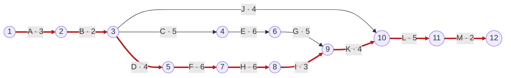

# Сетевое планирование разработки сайта «РАСтишка»

Учебная модель полного цикла разработки MVP методом критического пути (CPM).

**Статус:** предлагаемый план с расчётными длительностями. Это не история фактических работ, не оценка оставшейся разработки и не подтверждение готовности сайта. Длительности необходимо согласовать с исполнителями перед использованием для реального календарного планирования.

## 1. О чём исходная презентация

Изучены все 35 слайдов презентации «Методы сетевого планирования.ppt», включая таблицы, сетевые графики и формулы.

- Слайды 1–7 объясняют проект как набор взаимосвязанных работ и ставят задачу определения минимального срока. Часть работ идёт последовательно, часть можно выполнять одновременно.
- Слайды 8–13 знакомят с диаграммой Ганта, CPM и PERT. Гант показывает размещение работ во времени. CPM использует заданные длительности. PERT учитывает неопределённость длительностей; подробного расчёта PERT в презентации нет.
- Слайды 14–23 вводят работы, события, пути, критический путь и правила построения графика. Вершины обозначают события, стрелки — работы. Фиктивные работы имеют нулевую длительность и отражают логические зависимости.
- Слайды 24–32 показывают расчёт ранних и поздних сроков событий и работ, полного и свободного резервов.
- Слайды 33–35 объединяют действия в алгоритм: таблица работ, диаграмма Ганта, события, сетевой график, расчёт сроков и определение критического пути.

Основной подробно разобранный метод — CPM. Критический путь является самым продолжительным полным путём от старта до завершения. Он задаёт нижнюю границу срока при принятых зависимостях и длительностях. Работы этого пути имеют нулевой полный резерв.

В учебном примере реконструкции торгового центра срок равен 26 неделям. По буквенным обозначениям таблицы критическая цепочка: A → E → F → G → J. На части рисунков последняя работа обозначена I, хотя в таблице стоит J.

**Уточнение к слайду 32:** отсутствие сдвига раннего начала следующих работ определяется свободным резервом. Полный резерв позволяет сохранить конечный срок проекта, но следующие работы при этом могут сдвинуться. Эти резервы нельзя подменять друг другом. Кроме того, для проверки критической работы нужен её нулевой полный резерв: одних нулевых резервов двух соединённых событий недостаточно.

## 2. Применение к проекту «РАСтишка»

Цель: разработать и передать в эксплуатацию сайт коррекционного детского сада, через который родители знакомятся с учреждением и отправляют анкету предварительной записи, соискатели откликаются на вакансии, а сотрудники обрабатывают обращения и управляют контентом.

Объём модели основан на ТЗ версии 1.2 от 06.09.2026: публичный сайт, семишаговая анкета, новости, вакансии, отклики с резюме, админ-панель, роли, уведомления и защита данных. В этой редакции размещение приложения и PostgreSQL предусмотрено в Railway, основной домен — rastishka.pro. Это сведения ТЗ, а не результат проверки текущего развёртывания.

Каталог товаров, корзина, онлайн-оплата и личный кабинет родителей в модель не включены, поскольку в ТЗ они находятся за границами MVP.

## 3. Допущения расчёта

1. Единица времени — рабочий день. Начало проекта обозначено моментом 0. Интервал 0–3 означает три дня работы, то есть рабочие дни 1–3.
2. Все связи имеют тип «окончание — начало», без задержки между работами.
3. Участник 1 отвечает за UX/UI, публичные страницы и интерфейсы форм. Участник 2 — за архитектуру, серверную часть, админ-панель и интеграции. Это соответствует предлагаемому разделению отчётов в материалах проекта.
4. Работы A, B, K, L, M выполняются совместно. В раннем расписании один участник не занят одновременно на двух работах.
5. Представитель детского сада и согласующие выполняют J параллельно разработке. Четыре дня на согласования — учебная оценка, которую требуется подтвердить. Начальная версия требований фиксируется в B, окончательные тексты и документы утверждаются в J до общей приёмки.
6. В C создаются макеты публичной части и общие правила оформления. Админ-панель в H использует эти правила и готовые компоненты. При необходимости отдельного дизайна админ-панели его нужно добавить в модель.
7. В F реализуется базовая обработка форм и сохранение данных. В I завершаются уведомления и защищённая выдача резюме через админ-панель. Последовательность F–H–I учитывает работу одного серверного разработчика, хотя часть задач технически можно разделить при расширении команды.
8. Страницы и интеграция могут проверяться с тестовыми текстами и данными. Окончательные документы и контент обязательны к началу L. Запуск с реальными данными входит только в M после приёмки.
9. D включает подготовку тестового окружения. L включает проверку пользовательских сценариев, прав доступа, ошибок, адаптивности и исправления. M включает выпуск, проверку основных сценариев, восстановления и передачу документации.
10. Срок 35 дней не содержит отдельного буфера на непредвиденные задержки и не учитывает отпусков или праздников. При пятидневной неделе это семь рабочих недель. Календарная дата окончания зависит от даты старта и рабочего календаря.

## 4. Содержание, последовательность и длительность работ

| Работа | Содержание | Непосредственные предшественники | Дней | Исполнитель |
|---|---|---|---:|---|
| A | Анализ предметной области и требований | — | 3 | Оба |
| B | Подготовка и согласование ТЗ | A | 2 | Оба |
| C | Структура сайта, UX/UI, адаптивные макеты | B | 5 | Участник 1 |
| D | Архитектура, модель БД, тестовое окружение | B | 4 | Участник 2 |
| E | Публичные страницы сайта | C | 6 | Участник 1 |
| F | Серверная обработка форм, БД, авторизация и роли | D | 6 | Участник 2 |
| G | Интерфейсы анкеты записи и отклика на вакансию | E | 5 | Участник 1 |
| H | Админ-панель и управление контентом | F | 6 | Участник 2 |
| I | Уведомления и защищённая выдача резюме | H | 3 | Участник 2 |
| J | Контент, политика обработки данных, согласия | B | 4 | Представитель сада и согласующие |
| K | Интеграция всех модулей | G, I | 4 | Оба |
| L | Тестирование, исправления и приёмка | J, K | 5 | Оба |
| M | Запуск, проверка восстановления, документация | L | 2 | Оба |

Перед интеграцией K должны закончиться обе ветки разработки: G и I. Перед тестированием L должны закончиться интеграция K и согласование материалов J. Сам факт того, что одна из входящих работ завершена, ещё не разрешает начинать следующую.

## 5. Сетевой график

График построен в обозначениях презентации: круги — события, стрелки — работы. Число рядом с буквой работы — длительность в рабочих днях. Красные стрелки образуют критический путь. Длина нарисованной стрелки не отражает длительность работы.



Фиктивные работы для этой сети не нужны: каждая работа имеет уникальную пару начального и конечного событий. Есть единственный старт и единственный финиш, циклы отсутствуют, номер начала каждой работы меньше номера её окончания.

## 6. События и их временные параметры

Tр — ранний срок события, Tп — поздний срок, R — резерв события. Все значения отсчитываются от старта проекта.

| Событие | Результат | Tр | Tп | R = Tп − Tр |
|---:|---|---:|---:|---:|
| 1 | Старт проекта | 0 | 0 | 0 |
| 2 | Анализ завершён | 3 | 3 | 0 |
| 3 | ТЗ согласовано | 5 | 5 | 0 |
| 4 | UX/UI и макеты готовы | 10 | 13 | 3 |
| 5 | Архитектура и тестовая среда готовы | 9 | 9 | 0 |
| 6 | Публичные страницы готовы | 16 | 19 | 3 |
| 7 | Серверная основа и роли готовы | 15 | 15 | 0 |
| 8 | Админ-панель готова | 21 | 21 | 0 |
| 9 | Обе ветки разработки завершены | 24 | 24 | 0 |
| 10 | Интеграция и согласование материалов завершены | 28 | 28 | 0 |
| 11 | Тестирование и приёмка завершены | 33 | 33 | 0 |
| 12 | Сайт запущен и документация передана | 35 | 35 | 0 |

Ранние сроки считаются вперёд:

**Tр(1) = 0; Tр(j) = max[Tр(i) + t(i,j)]** по всем стрелкам, входящим в j.

Поздние сроки считаются назад:

**Tп(12) = Tр(12) = 35; Tп(i) = min[Tп(j) − t(i,j)]** по всем стрелкам, выходящим из i.

Например, к событию 9 ведут две работы:

- G заканчивается в момент 16 + 5 = 21;
- I заканчивается в момент 21 + 3 = 24.

Поэтому Tр(9) = max(21, 24) = 24. Интеграция ждёт более позднюю ветку.

К событию 10 ведут K и J: Tр(10) = max(24 + 4, 5 + 4) = 28.

При обратном расчёте Tп(9) = 28 − 4 = 24. Для события 3 берётся минимум: min(13 − 5, 9 − 4, 28 − 4) = min(8, 5, 24) = 5.

## 7. Временные параметры и резервы работ

Для работы (i,j) длительностью t:

- РН = Tр(i), раннее начало.
- РО = Tр(i) + t, раннее окончание.
- ПО = Tп(j), позднее окончание.
- ПН = Tп(j) − t, позднее начало.
- Полный резерв Rп = Tп(j) − Tр(i) − t.
- Свободный резерв Rс = Tр(j) − Tр(i) − t.

| Работа | Код i–j | Дней | РН | РО | ПН | ПО | Rп | Rс | Критическая |
|---|---|---:|---:|---:|---:|---:|---:|---:|---|
| A | 1–2 | 3 | 0 | 3 | 0 | 3 | 0 | 0 | Да |
| B | 2–3 | 2 | 3 | 5 | 3 | 5 | 0 | 0 | Да |
| C | 3–4 | 5 | 5 | 10 | 8 | 13 | 3 | 0 | Нет |
| D | 3–5 | 4 | 5 | 9 | 5 | 9 | 0 | 0 | Да |
| E | 4–6 | 6 | 10 | 16 | 13 | 19 | 3 | 0 | Нет |
| F | 5–7 | 6 | 9 | 15 | 9 | 15 | 0 | 0 | Да |
| G | 6–9 | 5 | 16 | 21 | 19 | 24 | 3 | 3 | Нет |
| H | 7–8 | 6 | 15 | 21 | 15 | 21 | 0 | 0 | Да |
| I | 8–9 | 3 | 21 | 24 | 21 | 24 | 0 | 0 | Да |
| J | 3–10 | 4 | 5 | 9 | 24 | 28 | 19 | 19 | Нет |
| K | 9–10 | 4 | 24 | 28 | 24 | 28 | 0 | 0 | Да |
| L | 10–11 | 5 | 28 | 33 | 28 | 33 | 0 | 0 | Да |
| M | 11–12 | 2 | 33 | 35 | 33 | 35 | 0 | 0 | Да |

Пример для G: Rп = 24 − 16 − 5 = 3; Rс = 24 − 16 − 5 = 3 дня. Интерфейсы форм заканчиваются в момент 21, но интеграция сможет начаться только в момент 24.

У C полный резерв равен 3, а свободный равен 0. Если C задержится на два дня, начало E сдвинется, но конечный срок ещё сохранится. Это показывает разницу полного и свободного резервов.

Резервы C, E и G не складываются: это общий трёхдневный запас одной ветки. Если C использует два дня, на дальнейшие задержки этой ветки остаётся один день. Резерв J в 19 дней означает возможность завершить согласования к моменту 28 при принятых зависимостях, а не рекомендацию откладывать их.

## 8. Критический путь и срок

**A → B → D → F → H → I → K → L → M**

По событиям: **1 → 2 → 3 → 5 → 7 → 8 → 9 → 10 → 11 → 12**.

**Tкр = 3 + 2 + 4 + 6 + 6 + 3 + 4 + 5 + 2 = 35 рабочих дней.**

Остальные полные пути:

| Путь | Длительность | Отставание от критического |
|---|---:|---:|
| A–B–C–E–G–K–L–M | 32 дня | 3 дня |
| A–B–J–L–M | 16 дней | 19 дней |

Первый из них — подкритический. Общая сумма длительностей всех работ составляет 55 дней. При полностью последовательном выполнении это означало бы 55 дней, а показанная параллельная организация даёт 35 дней. Разница составляет 20 дней. Сумма 55 не является трудоёмкостью в человеко-днях: в некоторых работах участвуют два исполнителя, а J включает согласования.

35 дней — минимальный срок именно построенной модели при принятых зависимостях и оценках. Он не доказывает, что любую реализацию проекта можно закончить за это время.

## 9. Диаграмма Ганта по ранним срокам

Один символ — один рабочий день. Вертикальная черта отделяет рабочие недели. «█» означает выполнение, «·» — отсутствие работы. День 1 соответствует интервалу 0–1 в расчётной таблице.

```text
Работа  Нед.1|Нед.2|Нед.3|Нед.4|Нед.5|Нед.6|Нед.7
        12345|67890|12345|67890|12345|67890|12345
A       ███··|·····|·····|·····|·····|·····|·····
B       ···██|·····|·····|·····|·····|·····|·····
C       ·····|█████|·····|·····|·····|·····|·····
D       ·····|████·|·····|·····|·····|·····|·····
E       ·····|·····|█████|█····|·····|·····|·····
F       ·····|····█|█████|·····|·····|·····|·····
G       ·····|·····|·····|·████|█····|·····|·····
H       ·····|·····|·····|█████|█····|·····|·····
I       ·····|·····|·····|·····|·███·|·····|·····
J       ·····|████·|·····|·····|·····|·····|·····
K       ·····|·····|·····|·····|····█|███··|·····
L       ·····|·····|·····|·····|·····|···██|███··
M       ·····|·····|·····|·····|·····|·····|···██
```

Участник 1 выполняет C–E–G и заканчивает свою отдельную ветку в момент 21. Участник 2 выполняет D–F–H–I и заканчивает в момент 24. После этого оба выполняют K–L–M. Свободный интервал участника 1 можно использовать для подготовки сценариев приёмки или документации без изменения базового плана; это не меняет рассчитанных длительностей автоматически.

## 10. Выводы для управления проектом

Основной контроль сроков нужен на серверной ветке D–F–H–I и на совместных этапах K–L–M. Если одна критическая работа увеличится на день и остальные параметры сохранятся, общий срок увеличится на день.

Чтобы сократить срок до 34 дней, можно проверить возможность сокращения одной критической работы на день, например K с четырёх до трёх дней за счёт заранее согласованных форматов обмена данными. Это сценарий оптимизации, а не подтверждённая оценка. После любого изменения сеть пересчитывается.

Ускорение только C, E или G при сохранении всех остальных оценок не уменьшит срок 35 дней: интеграция всё равно ждёт серверную ветку. Перенос задач между участниками требует проверки их компетенций, занятости и новых зависимостей.

Для реального плана завершения уже существующего проекта необходимо отдельно зафиксировать выполненные и принятые работы, оценить остаток и пересчитать график. Архивный аудит и статус требования в старом документе не заменяют актуальную приёмку.

## 11. Формулировка для учебного отчёта

Для планирования разработки сайта коррекционного детского сада «РАСтишка» применён метод критического пути CPM. Разработка представлена сетевой моделью из 13 работ и 12 событий. Для каждой работы определены длительность и непосредственно предшествующие работы. Выполнен прямой и обратный расчёт временных параметров, определены полные и свободные резервы. При принятых плановых оценках критический путь проходит через работы A–B–D–F–H–I–K–L–M, а продолжительность проекта составляет 35 рабочих дней. Ветка проектирования и разработки пользовательского интерфейса имеет общий резерв три дня. Полученные результаты позволяют выделить работы, задержка которых непосредственно влияет на дату завершения проекта. Длительности являются учебными оценками и требуют подтверждения для практического применения.

## 12. Источники

1. [Презентация «Методы сетевого планирования», 35 слайдов](C:/Users/HP/Downloads/Методы%20сетевого%20планирования.ppt). Слайды 14–35 — основа сетевой модели, обозначений и расчёта.
2. [Техническое задание «РАСтишка», версия 1.2](../Rastishka_Final_TZ_v1.2.docx), 06.09.2026. Основа состава MVP и требований к результату.
3. [Разделение проекта между двумя участниками](../REPORT_WORK_DIVISION.md). Основа предлагаемого распределения ролей.

Длительности, зависимости укрупнённых работ и расчётная модель предложены для этой учебной работы. Они не взяты из презентации или фактического журнала разработки.
